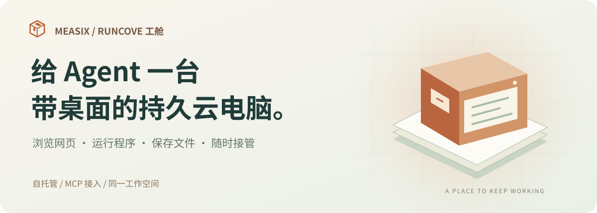
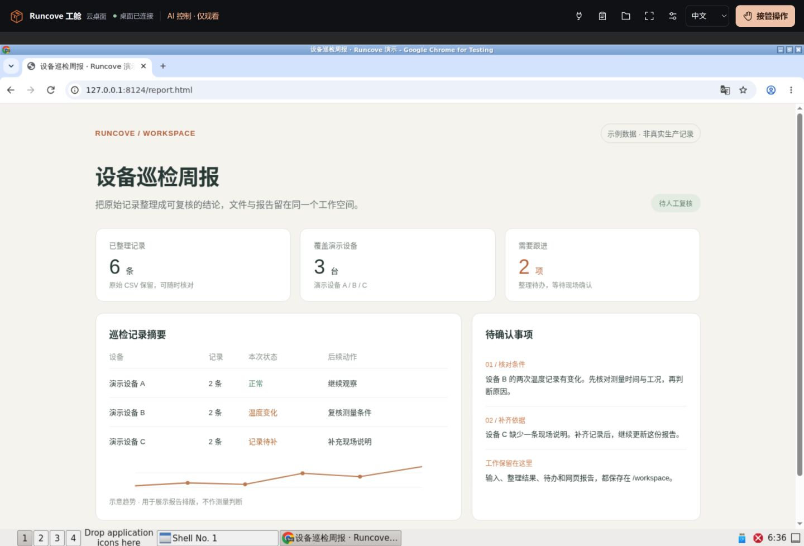
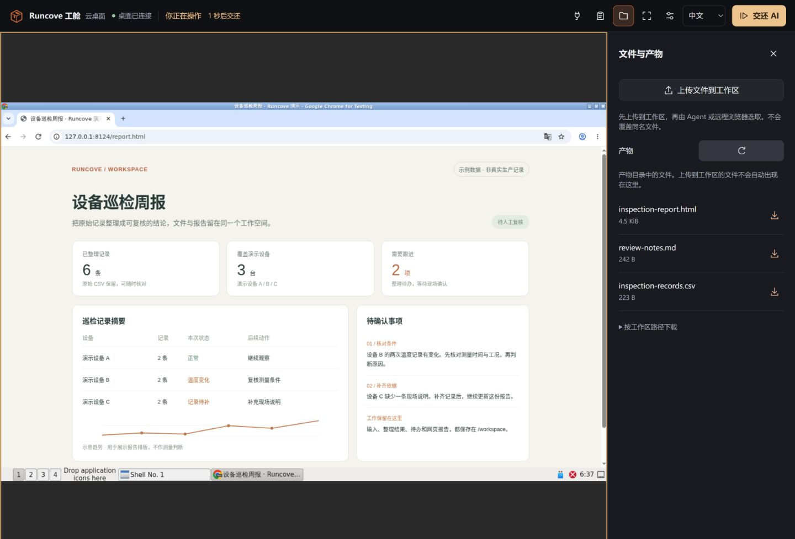
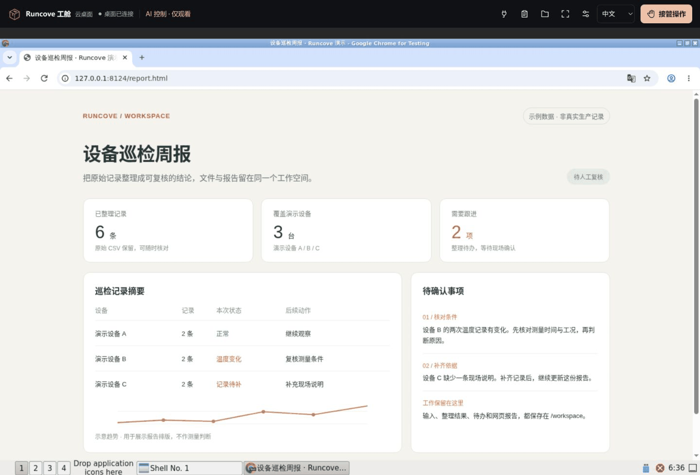
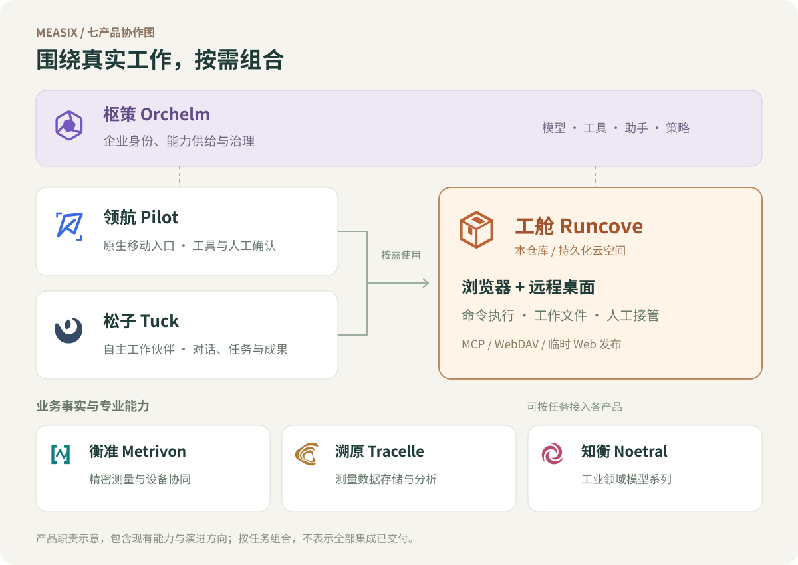

# Measix Runcove · 工舱



**Runcove 是供 Agent 使用、也能由你随时接管的持久化云空间。** 浏览器、桌面、程序和工作文件放在一起，部署在你自己的服务器上，通过 MCP 连接 Tuck 或其他 Agent 客户端。

[看真实桌面](#你和-agent-共用一个工作空间) · [与 Tuck 搭配](#与-tuck-搭配从交办到交付) · [开始使用](#开始使用) · [Measix 七产品](#在-measix-中的位置) · [文档](#文档)

## 一项工作，应该有自己的地方

个人 Agent 要持续做事，需要能够反复回到同一个环境：上次整理的文件还在，浏览器资料可以继续使用，程序能在明确的工作目录里运行，你也能打开桌面检查进度、补充信息或接手操作。

Runcove 为这些工作提供一个长期保留的空间。你可以把它用于个人助理的云电脑，也可以为团队的 Agent 分配各自的工作环境。

| 你想完成的事 | Runcove 提供的工作环境 |
|---|---|
| 查阅网页、整理资料、生成报告 | 浏览器、命令执行与文件工具共用工作区，输入和交付文件保存在一起 |
| 遇到登录、人工确认或需要接手的步骤 | 打开同一个可见桌面，接管鼠标键盘，完成后交还 Agent |
| 下次继续处理同一项目 | 保留工作目录；Server 还持久化空间根盘，按需唤醒空间 |
| 把成果带回自己的工具和流程 | 从工作台下载，使用 WebDAV 交换文件，或临时发布网页与应用 |
| 自己掌握运行环境和文件落点 | 在自己的 Docker 主机部署，选择单空间容器或多空间 microVM |

模型调用、任务规划、长期记忆和调度由接入的 Agent 负责；Runcove 负责它工作的地方、使用的工具和留下的文件。空间持久化保留数据，任务是否自动续跑取决于 Agent 本身。

## 你和 Agent 共用一个工作空间

下面是隔离演示空间的实际界面：通过 MCP 写入工作文件、打开浏览器，再从 Runcove 工作台查看报告。报告和记录均为演示资料。



*同一个浏览器、同一份资料。工具栏可以切换观看与人工控制，Agent 与人共用这台工作电脑。*



*工作资料保存在 `/workspace/inspection-weekly`，交付副本集中在产物面板；其他工作区文件可按路径下载。*

<details>
<summary>查看操作片段：观看 → 接管 → 文件面板 → 交还 AI</summary>



实机关键帧动图；展示桌面与文件交互，不代表一段完整模型自主执行。截图来源和更新方式见[媒体维护](docs/development.md#readme-媒体维护)。

</details>

## 与 Tuck 搭配：从交办到交付

[**Measix Tuck · 松子**](https://github.com/topabomb/measix-tuck) 是我们已经公开的自托管 Agent 工作台，承接对话、任务、工作文件和交付成果。**Tuck 接住你交办的工作，Runcove 提供浏览器、桌面与持久工作空间。**

例如，把一组巡检记录交给 Tuck：它通过 MCP 在 Runcove 中整理文件、运行脚本、查阅网页并生成报告；你可以打开 Runcove 桌面检查过程，需要时接管，再从同一工作区取回成果。

接入时，将 Runcove 的 MCP 地址和凭据配置到客户端。Standalone 使用 `/mcp`，Server 使用 `/u/{username}/mcp`；桌面凭据及文件访问方式见[部署指南](docs/deployment.md)和[Server 接入参考](docs/server-api.md)。其他支持相应 HTTP MCP 传输与认证方式的客户端也可接入。

## 开始使用

两种部署共用 Rust 核心、浏览器工具和桌面工作台：

| | **Standalone：个人单空间** | **Server：托管多空间** |
|---|---|---|
| 适合谁 | 为自己或一个 Agent 准备工作电脑 | 为团队、用户或外部平台分配空间 |
| 运行方式 | 一个 Docker 容器直接运行一个空间 | microsandbox 为各空间提供 microVM |
| 持久内容 | `/workspace`，包含工作文件与浏览器资料 | 用户状态、空间根盘与工作卷 |
| 主机要求 | Linux Docker，无需 KVM | Linux Docker，需 `/dev/kvm` |
| 管理方式 | 单份配置和访问凭据 | 用户、凭据、资源及空间生命周期管理 API |
| 工具、浏览器与桌面权限 | UID/GID1001，服务控制进程使用 root | VM 内统一 root，核心服务在 VM 外 |
| 依赖安装 | Agent 安装项目依赖，系统依赖由镜像提供 | Agent 可在 VM 内管理项目和系统依赖 |
| 部署入口 | [单空间构建与启动](docs/deployment.md#独立单空间构建与启动) | [Server 构建与部署](docs/deployment.md) |

先体验个人单空间，从源码构建：

```bash
git clone https://github.com/topabomb/measix-runcove.git
cd measix-runcove/agent-space
bash docker/build-standalone.sh
```

构建完成后，按[部署指南](docs/deployment.md#独立单空间构建与启动)设置镜像标签、访问凭据和持久卷，再用仓库 Compose 启动。桌面入口是 `/desktop/`，外部 WebDAV 默认关闭。

当前镜像验证范围为 **Linux/amd64**。ARM 与具体 NAS 型号需要单独验收。自托管决定执行环境和文件的位置；若客户端调用外部模型，发送给模型的内容仍由客户端和模型配置决定。

## 在 Measix 中的位置

Measix 围绕“可信业务事实、专业能力、人的入口、Agent 工作与企业治理”组织七个产品。Runcove 承担其中的**持久化工作空间**，也可以独立部署使用。



| 产品 | 主要职责 |
|---|---|
| **衡准 Metrivon** | 精密测量、设备协同与确定性计算，形成可信的业务事实 |
| **溯原 Tracelle** | 保存、查询与分析测量数据，保留原始依据和上下文 |
| **知衡 Noetral** | 面向工业任务的领域模型能力 |
| [**领航 Pilot**](https://github.com/topabomb/measix-pilot) | 原生移动 Agent 入口，承接现场交互、工具使用与人工确认 |
| [**松子 Tuck**](https://github.com/topabomb/measix-tuck) | 员工专属的自主工作伙伴，组织对话、任务、进展与成果 |
| **工舱 Runcove** | 带浏览器和桌面的持久空间，提供程序运行与文件环境 |
| **枢策 Orchelm** | 企业身份、模型、工具、助手与策略的供给和治理 |

这张图描述产品职责与演进方向；各产品按任务需要组合，具体集成以对应版本为准。

## microsandbox 与项目定位

[microsandbox](https://github.com/superradcompany/microsandbox) 提供本地优先的 microVM 运行时。**Runcove Server 以它作为空间托管引擎**，在其上提供用户空间、远程 MCP、桌面工作台与文件交付。Runcove Workspace 是 Server 使用的桌面 VM rootfs；Standalone 共用应用核心，在单容器中直接运行。

当前 Server 锁定的版本、临时补丁及升级条件见[运行时维护](docs/runtime.md)。microsandbox 的入门与运行时能力见[官方文档](https://docs.microsandbox.dev/getting-started/introduction)。

<details>
<summary>相关项目与定位参考</summary>

以下按 **2026-10-16** 核对的项目文档概括定位，链接固定到当时版本；没有做跨项目运行测试或性能排名。

| 项目 | 公开定位与能力 | 与 Runcove 的侧重点区别 |
|---|---|---|
| [microsandbox-mcp（官方）](https://github.com/superradcompany/microsandbox-mcp/blob/ff60d5328dd5c7162e45d88e317e260e1b11ea66/README.md) | 通过 stdio MCP 将 SDK 的沙箱创建、执行、文件、卷、快照及监控能力交给 Agent | 适合直接驱动运行时；Runcove 侧重已分配的持久空间、用户级远程 HTTP 访问和配套工作台 |
| [Holm（第三方）](https://github.com/holm-inc/holm/blob/2590c3b62f32ad3978231fd0397943097d7ce0b1/README.md) | 支持容器/VM 与多种后端的桌面控制，含观看、接管、REST 和 HTTP MCP；提供可选 microsandbox 集成 | 桌面与接管能力存在重叠；Runcove 聚焦两种部署入口、用户空间生命周期、DAV 文件交换及成套离线交付 |
| [agent-sandbox（第三方）](https://github.com/ErRickow/agent-sandbox/blob/994c060f5bbbeb99a8791fd83d8e65337876f395/README.md) | 以统一运行接口和 skills 适配 E2B、Vercel、Daytona、Modal、microsandbox，提供命令与 agent-browser 能力 | 适合在多个 provider 间复用任务；Runcove 当前聚焦自托管空间及其浏览器、文件和管理合同 |

选型取决于需要运行时工具、跨后端适配，还是完整的托管工作空间。上面的能力组合是本项目的产品取舍，不表示相关能力为本项目独有，也不表示其他项目缺少相应扩展。

</details>

## 文档

| 想了解什么 | 阅读入口 |
|---|---|
| 安装、配置、Compose 与离线包 | [部署指南](docs/deployment.md) |
| 升级、备份、迁移与恢复 | [运维手册](docs/operations.md) |
| 接入用户、凭据和空间管理 | [Server API](docs/server-api.md) |
| 浏览器、桌面、控制权与工作台 | [浏览器与云桌面](docs/browser-desktop.md) |
| 文件交换与成果发布 | [WebDAV](docs/webdav.md) · [Web 发布](docs/web-publish.md) |
| 代码职责、共享核心与贡献方式 | [架构](docs/architecture.md) · [开发指南](docs/development.md) |
| 运行时来源与已验证范围 | [运行时维护](docs/runtime.md) · [验证记录](docs/validation-records.md) |

## 参与开发

源码位于 `agent-space/`。提交问题时请注明部署方式、平台、源码或镜像版本、复现步骤和脱敏错误。开发约定见 [AGENTS.md](AGENTS.md)，构建与回归命令见[开发指南](docs/development.md)。

目前维护中文文档；英文入口与目录结构已有[规划](docs/development.md#双语结构规划)。公开 Git 历史从整理后的首次提交开始，历史验证记录仅适用于各自注明的输入与范围。

## 致谢

感谢 [microsandbox](https://github.com/superradcompany/microsandbox) 的维护者和贡献者提供 microVM 基础，并持续处理社区反馈。也感谢 [libkrun](https://github.com/containers/libkrun)、[smoltcp](https://github.com/smoltcp-rs/smoltcp) 以及本项目所依赖的开源工具。Runcove 的空间服务、桌面和集成建立在这些工作的基础上。
